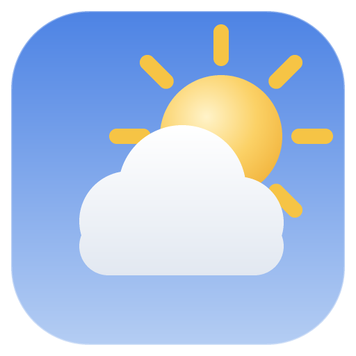

<p align="center"></p>

# Glass Weather Card
[](https://github.com/iamBiB/ha-glass-weather-card/releases/latest)

A glass weather card for [Home Assistant](https://www.home-assistant.io/) with an animated sky that follows the weather. Tap a day in the forecast row and the whole card switches to that day: sky, numbers and colours.

<!-- TODO: screenshots (sunny, rain, thunder, snow, compact) -->

## Features
- **Animated sky.** A glowing sun with turning rays, drifting clouds, rain, forked lightning with flashes, snow, hail, fog banks, wind streaks, and a night sky with the moon and twinkling stars. Scenes blend into each other when the weather or the selected day changes.
- **Forecast row.** Today plus up to six days, each with a small animated weather icon. Selecting a day shows its high and low, feels like, humidity and wind. After 30 seconds the card returns to today.
- **Clock and date** next to the temperature, in your 12/24 h setting.
- **Feels like for every integration.** When the weather integration doesn't report one (Met.no, for example), the card calculates it from temperature, humidity and wind.
- **Your own sensor** for the current temperature, if you prefer it to the forecast service's value.
- **Any size.** Full width by default. In the sections view it fills whatever size you give it; in masonry it follows its content. A compact view is available for smaller spaces.
- **Day and night.** After sunset the sky turns dark, sunny becomes a clear night, and cloudy, rain and snow get darker colours.
- **Visual editor**, card picker preview, and a suggestion on weather entities.
- **Light on resources.** One file, no dependencies, no external requests (no web fonts, no CDNs). Animation pauses when the card is off screen or the tab is hidden.
- **Accessible.** Day pills work with the keyboard (arrow keys, Home, End). Animations stop when "reduce motion" is on, or with `animations: false`.
- **Optional sound.** Synthesised rain, wind and thunder, off by default.

<!-- ha-marketplace:exclude-start -->
## Install

### Marketplace
Requires Home Assistant 2026.11 or newer.

1. Go to **Settings → Marketplace**.
2. In the upper-right corner, select **Add from link**.
3. Under **GitHub link**, enter `iamBiB/ha-glass-weather-card` and select **Add**. If Marketplace asks for the type, choose **Dashboard** and select **Add** again. The first time you add a repository by link, Marketplace asks you to connect GitHub: select **Continue** and enter the code shown on GitHub.
4. Open **Glass Weather Card**, select **Install**, check the version, and select **Install** again.
5. Refresh your browser (Ctrl/Cmd+Shift+R).

Marketplace adds the dashboard resource for you. Updates appear under **Settings → Updates**.

### Manual install
1. Download `glass-weather-card.js` from the latest [release](https://github.com/iamBiB/ha-glass-weather-card/releases/latest) (or from the `dist` folder) and copy it to `config/www/glass-weather-card/glass-weather-card.js`.
2. Add the resource: **Settings → Dashboards → ⋮ (top right) → Resources → Add resource**. Enter `/local/glass-weather-card/glass-weather-card.js?v=1.0.0` and choose **JavaScript module**.
3. Refresh your browser (Ctrl/Cmd+Shift+R).
<!-- ha-marketplace:exclude-end -->

## Updating
- **Marketplace:** install the update when it shows up under **Settings → Updates**, then refresh the browser (Ctrl/Cmd+Shift+R).
- **Manual:** copy the new `glass-weather-card.js` over the old one, then bump the `?v=` number in the resource URL so browsers load the new version.

The browser console shows the loaded version as `GLASS-WEATHER-CARD v1.0.0`.

## Using the card
Add it from the card picker (search for **Glass Weather Card**) and set it up in the visual editor, or use YAML.

### Options

| Name | Type | Default | Description |
|------|------|---------|-------------|
| `type` | string | **required** | `custom:glass-weather-card` |
| `entity` | string | **required** | A `weather.*` entity. |
| `name` | string | friendly name | Text in the header instead of the weather entity's name. |
| `temperature_entity` | string | — | A sensor to show as the current temperature instead of the weather entity's. Falls back to the weather entity when the sensor has no number; °C/°F are converted. Forecast days are unchanged. |
| `forecast_type` | string | `daily` | `daily` or `twice_daily`. Falls back to the other one if the entity doesn't support it; with neither, the forecast row is hidden. |
| `days` | int | `5` | Pills in the forecast row, today included (max 7). `0` hides the row. |
| `show_clock` | bool | `true` | Clock to the right of the temperature, with the selected day's date under it. |
| `show_location` | bool | `true` | Pin icon and name in the header. With it off (and no sound button) the header row is hidden. |
| `compact_view` | bool | `false` | Shorter card: temperature at about half size, no empty sky above it, one-line info tiles and smaller pills. Its height follows its content. |
| `animations` | bool | `true` | `false` shows a still sky. "Reduce motion" on the device does the same. |
| `sound` | bool | `false` | Shows a sound button. Audio starts only when you click it. |
| `border_radius` | int | theme | Corner radius in px. |
| `height` | string | auto | Fixed height, e.g. `480px` or `480`. Mostly for the masonry view; in the sections view, resize the card instead. |
| `tap_action` | action | `more-info` | Action for the header and the temperature area. `action: none` turns it off. |

### Examples

#### Standard card
```yaml
type: custom:glass-weather-card
entity: weather.home
```

#### Compact, no header
```yaml
type: custom:glass-weather-card
entity: weather.home
compact_view: true
show_location: false
```

#### Your own outdoor sensor for the current temperature
The weather entity's temperature comes from a forecast service and can differ from your own sensor:
```yaml
type: custom:glass-weather-card
entity: weather.home
name: Garden
temperature_entity: sensor.outdoor_temperature
```

#### A week ahead, twice-daily forecast, no animations
```yaml
type: custom:glass-weather-card
entity: weather.home
forecast_type: twice_daily
days: 7
animations: false
```

### Size
- **Sections view:** the card starts at full width and 8 rows (compact view: as tall as its content). There are no minimum or maximum sizes, so resize it as you like. Everything inside scales with the card; when the height gets too small, the info tiles and then the forecast row are dropped instead of being cut off.
- **Masonry view:** the card is as wide as its column and as tall as its content, unless you set `height`.

### Weather conditions

| Condition | Sky |
|---|---|
| `sunny` | Sun (clear night after sunset) |
| `clear-night` | Moon and stars |
| `partlycloudy` | Sun with clouds (moon and clouds at night) |
| `cloudy` | Clouds |
| `fog` | Clouds and fog banks |
| `windy`, `windy-variant` | Fast clouds and wind streaks |
| `rainy` | Rain |
| `pouring` | Heavy, slanted rain |
| `lightning` | Storm clouds and lightning |
| `lightning-rainy` | Storm clouds, lightning and rain |
| `snowy` | Snow |
| `snowy-rainy` | Snow and rain |
| `hail` | Hail |
| `exceptional`, `unknown`, `unavailable` | Grey, still sky; the card shows the state |

Forecast days use the condition the integration reports for that day. Values the integration doesn't provide are shown as `–`.

## Development
No build step. Serve the repository and open the test page:

```sh
python3 -m http.server 8000
# open http://localhost:8000/dev/
```

The test page mounts the card with a mock `hass`. It can switch through all conditions, day and night, widths from 250 to 1200 px, masonry and sections sizing, missing attributes, a failing forecast, a second card, and detaching and reattaching the card (the live subscription counter should drop to 0).

## License
[MIT](LICENSE)
